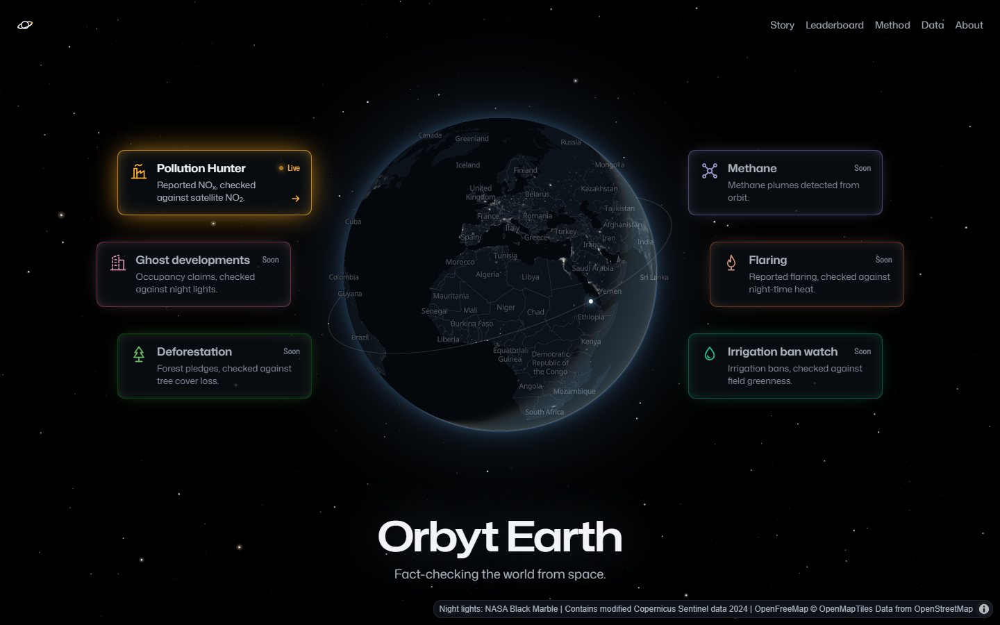
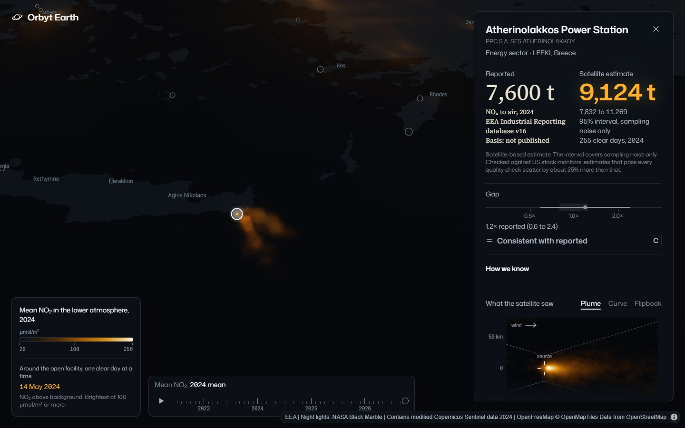
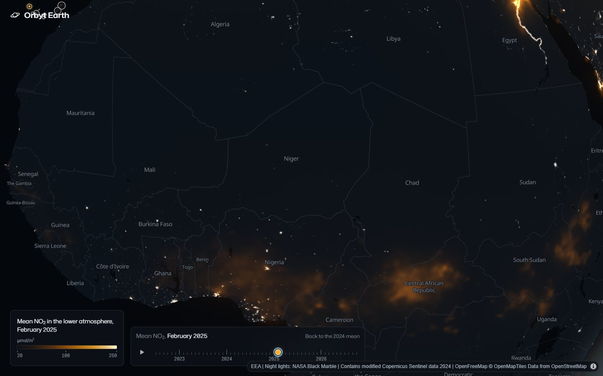

# Orbyt Earth

Orbyt Earth fact-checks the world from space. Each module puts what was officially reported next to what a satellite measured, then shows the gap on an interactive 3D globe. The first module, Pollution Hunter, compares the NOx emissions that European facilities report to the EU register with satellite-based estimates of the same plumes. Everything is public, map-based and built to be shared.

Live: https://orbyt-earth.pages.dev

## How it works

- Sentinel-5P satellite data shows nitrogen dioxide plumes drifting away from large industrial sites.
- Each day's image is rotated to follow the wind, then stacked over many clear days so the plume stands out from the noise.
- A curve fit turns the stacked plume into an emission estimate with an uncertainty range.
- That estimate is compared with the figure the facility reported to the official register.

## Tech stack

- Frontend: React, TypeScript, Vite, Tailwind CSS
- Map and globe: MapLibre GL JS, deck.gl
- Pipeline: Python, NumPy, SciPy, DuckDB, Parquet
- Data: Google Earth Engine (Sentinel-5P, ERA5 wind), EEA Industrial Reporting database
- Hosting: Cloudflare Pages

Status: in progress
